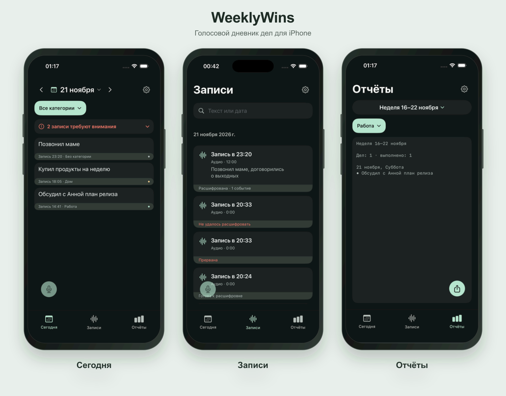

# WeeklyWins

Голосовой дневник дел для iPhone. Расскажите, чем занимались, получите расшифровку и редактируемые события, а затем просмотрите их в ленте дня или отчётах.

*A Russian-first, voice-driven daily log for iOS.*

## Скриншоты

Три основных экрана приложения: лента дня, список записей и отчёты.



## Возможности

- Голосовая запись до пяти минут, в том числе с кнопки действия iPhone.
- Расшифровка средствами Apple Speech с обработкой на устройстве.
- Автоматическое извлечение событий из текста с возможностью исправить текст и категорию.
- Категории: «Работа», «Дом», «Хобби» и «Без категории».
- Поиск по расшифровкам, событиям и датам; ежедневные, недельные и месячные отчёты.
- Настраиваемый промпт для внешней модели добавляется к исходному отчёту при отправке через системное меню «Поделиться».
- Просмотр общего объёма аудиофайлов и настраиваемое автоудаление старых файлов. Расшифровки и события сохраняются.
- Импорт и экспорт расшифровок в JSON. Импорт/экспорт включает текст и метаданные записей, но не аудиофайлы. Имя файла экспорта содержит число записей и дату выгрузки.

## Данные и разрешения

Записи, расшифровки и события хранятся в локальном контейнере приложения. Распознавание речи настроено на устройстве; iOS может загрузить речевые ресурсы при первом использовании. Доступность модели зависит от языка и версии iOS. В исходном коде приложения нет собственного сервера, учётной записи или облачной синхронизации.

Промпт отчёта хранится локально и включается в текст только при выборе «Поделиться».

Для записи требуется доступ к микрофону, для расшифровки — разрешение на распознавание речи. Приложение запрашивает их в контексте соответствующего действия.

## Требования

- iOS 26.0 или новее.
- Xcode 26 или новее.
- На iPhone для подписи сборки выберите собственную команду разработки в настройках Signing & Capabilities.

## Сборка

Откройте `WeeklyWins.xcodeproj`, выберите схему `WeeklyWins` и запустите её на симуляторе или устройстве.

Сборка из командной строки:

```sh
xcodebuild -project WeeklyWins.xcodeproj \
  -scheme WeeklyWins \
  -destination 'platform=iOS Simulator,name=iPhone 17 Pro' \
  build
```

`project.yml` — спецификация XcodeGen. Сам `.xcodeproj` хранится в репозитории; если вы меняете `project.yml`, сгенерируйте проект заново командой `xcodegen generate`.

## Тесты

```sh
xcodebuild -project WeeklyWins.xcodeproj \
  -scheme WeeklyWins \
  -destination 'platform=iOS Simulator,name=iPhone 17 Pro' \
  test
```

Основные тесты находятся в `WeeklyWinsTests` и `WeeklyWinsActionButtonUITests`. Некоторые сценарии пользовательского интерфейса рассчитаны на тестовые данные симулятора и пропускаются, если таких данных нет.

## Структура проекта

- `WeeklyWins/Recording` — запись аудио, локальное хранение, поиск и JSON-обмен.
- `WeeklyWins/Transcription` — распознавание речи и редактирование расшифровок.
- `WeeklyWins/Events` — извлечение и редактирование событий.
- `WeeklyWins/Reports` — лента дня и отчёты.
- `WeeklyWins/Design` и `docs/design` — компоненты интерфейса, спецификация и проверочные снимки.
- `WeeklyWinsTests` и `WeeklyWinsActionButtonUITests` — модульные и UI-тесты.

## Лицензия

Проект распространяется под лицензией [MIT](LICENSE). Она разрешает использовать, изменять и распространять код при сохранении уведомления об авторских правах и текста лицензии.
